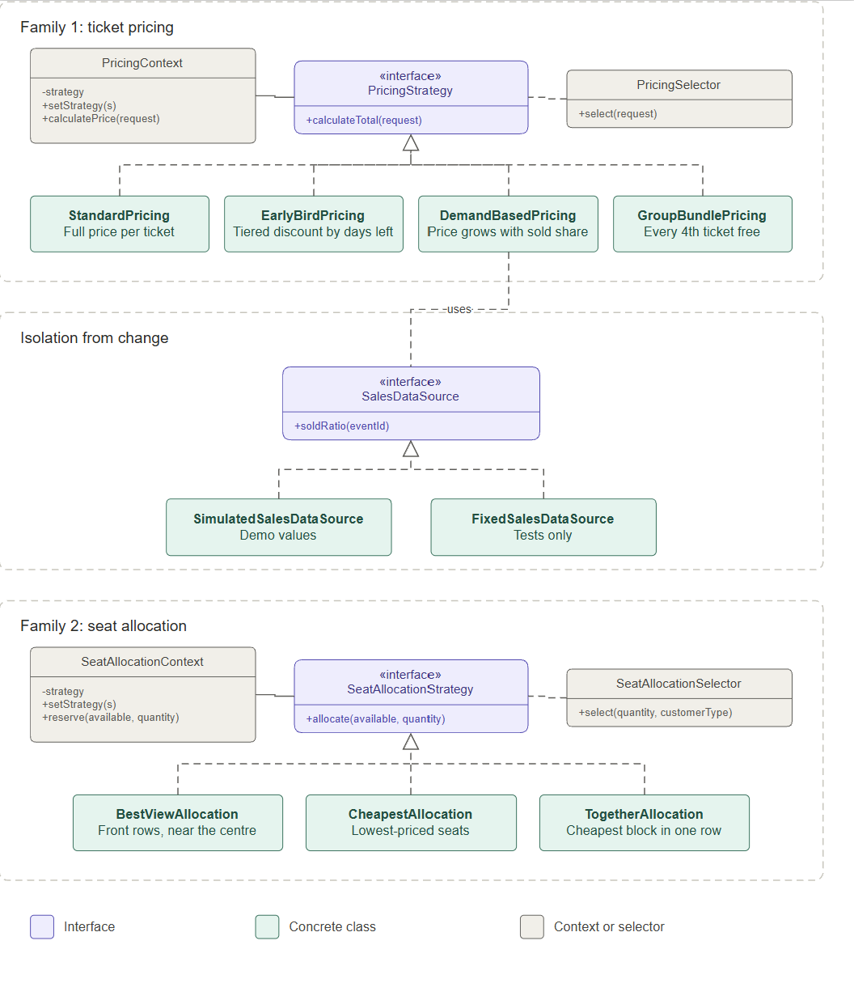

# Concert Ticketing: Strategy Pattern

Assignment 5. Software Design Patterns.

Author: Aiymay Tleu

Group: SE-2539


A ticket office sells seats for concerts.
It calculates the price of an order and chooses the seats for the customer.
Both operations can be done in several ways, so both are built with the Strategy pattern.

## 1. What the program does

| Family | Question it answers | Strategies |
|---|---|---|
| Ticket pricing | How much does this order cost? | `StandardPricing`, `EarlyBirdPricing`, `DemandBasedPricing`, `GroupBundlePricing` |
| Seat allocation | Which seats does the customer get? | `BestViewAllocation`, `CheapestAllocation`, `TogetherAllocation` |

Each family has one interface, several strategies, one context, and one selector.

| Family | Interface | Context | Selector |
|---|---|---|---|
| Ticket pricing | `PricingStrategy` | `PricingContext` | `PricingSelector` |
| Seat allocation | `SeatAllocationStrategy` | `SeatAllocationContext` | `SeatAllocationSelector` |

## 2. How each strategy works

| Strategy | Logic |
|---|---|
| `StandardPricing` | Base price multiplied by the number of tickets. |
| `EarlyBirdPricing` | Tiered by date: 25% off at 60 days or more before the concert, 15% off at 30 to 59 days, no discount below 30. |
| `DemandBasedPricing` | Reads the sold share (0..1) from the sales feed; price is multiplied by 1 + share squared, so a sold-out concert costs double. |
| `GroupBundlePricing` | In every group of four tickets one is free (8 tickets are paid as 6). |
| `BestViewAllocation` | Sorts free seats by row (closest to the stage first), then by distance to the centre line of the hall. |
| `CheapestAllocation` | Sorts free seats by price, then by row and number; the position in the hall does not matter. |
| `TogetherAllocation` | Looks for blocks of neighbouring seat numbers inside one row and takes the cheapest block; returns an empty list when no block is big enough. |

Every strategy has different logic, not only different numbers.

## 3. Context rules

`PricingContext` and `SeatAllocationContext` follow the same pattern:

- the strategy is passed in the constructor
- `setStrategy()` replaces it while the program runs
- the work is delegated to the strategy
- a `null` strategy is rejected

The contexts contain no `if`, `switch`, or `instanceof` on the strategy type.

## 4. Selectors

Selectors choose a strategy from the current situation.
Rules are checked from top to bottom, the first match wins.
`if` is used only in selectors, because choosing is their job.

**PricingSelector** (input: `TicketRequest` and the sold share from `SalesDataSource`)

| Priority | Condition | Chosen strategy |
|---|---|---|
| 1 | Order has 4 tickets or more | `GroupBundlePricing` |
| 2 | Sold share is 0.8 or more | `DemandBasedPricing` |
| 3 | 30 days or more before the concert | `EarlyBirdPricing` |
| 4 | Anything else | `StandardPricing` |

**SeatAllocationSelector** (input: number of tickets and `CustomerType`)

| Priority | Condition | Chosen strategy |
|---|---|---|
| 1 | Customer is VIP | `BestViewAllocation` |
| 2 | Regular customer, party of 2 to 6 | `TogetherAllocation` |
| 3 | Anything else | `CheapestAllocation` |

## 5. Isolation from change 

`DemandBasedPricing` needs to know how many seats are already sold.
It never talks to a real box-office system.
It depends only on our own interface `SalesDataSource`.
This is the same idea as `PortfolioManager` and `StockExchange` in the lecture.

| Implementation | Where | Purpose |
|---|---|---|
| `SimulatedSalesDataSource` | main code | Repeatable sold shares for the demo (a default value plus values for chosen events) |
| `FixedSalesDataSource` | tests | One fixed value, so every test gives the same result on every run; it also remembers which event was asked about |

A real box-office feed can be added as a new class without any change in the strategies.

## 6. Project structure

```
src/main/java/concert/
  ConcertTicketingDemo.java
  model/        CustomerType, 
                TicketRequest, 
                Seat
  data/         SalesDataSource, 
                SimulatedSalesDataSource
  pricing/      PricingStrategy, 
                four strategies, 
                PricingContext, 
                PricingSelector,
                PricingType, 
                TicketPriceCalculator
  seating/      SeatAllocationStrategy, 
                three strategies, 
                SeatAllocationContext,
                SeatAllocationSelector
src/test/java/concert/
  support/      FixedSalesDataSource,
                Requests, 
                Seats
  pricing/      TicketPriceCalculatorTest, 
                StandardPricingTest, 
                EarlyBirdPricingTest,
                DemandBasedPricingTest, 
                GroupBundlePricingTest, 
                PricingContextTest,
                PricingSelectorTest, 
                PricingStrategyContractTest
  seating/      BestViewAllocationTest, 
                CheapestAllocationTest, 
                TogetherAllocationTest,
                SeatAllocationContextTest, 
                SeatAllocationSelectorTest,
                SeatAllocationContractTest
```

## 7. Classes and responsibilities

| Class | Responsibility |
|---|---|
| `TicketRequest` | Describes one purchase wish: event, quantity, base price, dates, customer type. |
| `CustomerType` | Names the kinds of customers the box office knows. |
| `Seat` | Describes one seat of the hall: row, number, price. |
| `SalesDataSource` | Defines how the program reads the sold share of a concert from any sales feed. |
| `SimulatedSalesDataSource` | Supplies repeatable sold shares for the demo. |
| `FixedSalesDataSource` | Returns one fixed sold share so tests give the same result every run. |
| `PricingStrategy` | Declares the contract for calculating the total price of an order. |
| `StandardPricing` | Charges the full base price for every ticket. |
| `EarlyBirdPricing` | Lowers the price in tiers according to the days left before the concert. |
| `DemandBasedPricing` | Raises the price with the square of the sold share. |
| `GroupBundlePricing` | Gives every fourth ticket of an order for free. |
| `PricingContext` | Holds a pricing strategy, accepts replacements, delegates the calculation to the current strategy. |
| `PricingSelector` | Chooses a pricing strategy from group size, sold share, days left. |
| `PricingType` | Names the pricing variants for manual choice. |
| `TicketPriceCalculator` | Maps a pricing name to its strategy for manual choice. |
| `SeatAllocationStrategy` | Declares the contract for picking seats from the free ones. |
| `BestViewAllocation` | Picks seats nearest to the stage, then nearest to the centre line. |
| `CheapestAllocation` | Picks the lowest-priced seats of the hall. |
| `TogetherAllocation` | Picks the cheapest block of neighbouring seats inside one row. |
| `SeatAllocationContext` | Holds a seating strategy, accepts replacements, delegates the seat choice to the current strategy. |
| `SeatAllocationSelector` | Chooses a seating strategy from customer type, party size. |
| `ConcertTicketingDemo` | Runs the console demo comparing strategies, selectors, runtime switching. |

## 8. UML diagram



A solid line means "context holds a strategy".
Dashed lines with a hollow triangle mean "implements".
A dashed line without an arrow connects a selector to the strategy interface it chooses from.
A dashed line labelled "uses" goes from `DemandBasedPricing` to the data source.

## 9. Why this is Strategy and not State or Template Method

**Not State.**
In the State pattern an object changes its behavior when its own internal state changes.
The states know each other and trigger the transitions themselves, so the context moves from one state to the next.
Nothing like this happens here.
`PricingContext` and `SeatAllocationContext` never change their strategy by themselves.
A strategy does not know about the other strategies and never touches the context.
The choice always comes from outside: from the client (manual choice) or from a selector (automatic choice).
The strategies are also independent alternatives for the same job, not steps of a life cycle.
`EarlyBirdPricing` and `GroupBundlePricing` price the same order in different ways,
and no rule says that one of them must follow the other.

**Not Template Method.**
Template Method fixes the skeleton of an algorithm in a base class
and lets subclasses override single steps through inheritance.
The variant is chosen at compile time, because the subclass is the algorithm.
Here the whole algorithm is replaced, not one step of it.
Pricing by date, by demand, or by bundle has no shared skeleton, and neither has seat choice by view, by price, or by neighbourhood.
The variants are separate classes behind an interface and are linked to the context by composition.
The context can swap them at runtime with `setStrategy()`.
The demo shows this: the same `PricingContext` object returns a different price after the strategy is replaced.

**Open/Closed Principle.**
A new algorithm is a new class that implements the interface.
Neither the context nor the existing strategies change.
Only the selector needs one new rule, and only if the new strategy must be chosen automatically.

## 10. Tests (JUnit 5)

| Test class | What it checks |
|---|---|
| `TicketPriceCalculatorTest` | 8 behavior tests, identical on the before commit and the after commit |
| `StandardPricingTest` | Price equals base price times quantity, dates are ignored |
| `EarlyBirdPricingTest` | Both tiers and all boundaries (100, 60, 59, 30, 29, 0 days) |
| `DemandBasedPricingTest` | Empty, half full, sold out; asks the feed about the right event; rejects a missing feed |
| `GroupBundlePricingTest` | Paid tickets for 1, 3, 4, 7, 8, 12 tickets |
| `PricingContextTest` | Delegation, `setStrategy()` at runtime, `null` is rejected |
| `PricingSelectorTest` | Every pricing rule, rule priority, boundaries at 0.8 and 30 days |
| `PricingStrategyContractTest` | `@ParameterizedTest`: for all pricing strategies the price is never negative, never above double the full price, the name is not blank |
| `BestViewAllocationTest` | Front row first, centre seats first, next row when the front is full |
| `CheapestAllocationTest` | Lowest price first, neighbours are not required, empty result when seats are missing |
| `TogetherAllocationTest` | One row, neighbouring numbers, cheapest block, rows split by taken seats are skipped |
| `SeatAllocationContextTest` | Delegation, `setStrategy()` changes the rows at runtime, `null` is rejected |
| `SeatAllocationSelectorTest` | Every seating rule, VIP priority, party boundaries 1, 2, 6, 7 |
| `SeatAllocationContractTest` | `@ParameterizedTest`: for all seating strategies the result has the requested size, distinct free seats, and is empty when the hall is too small or zero tickets are asked |

All tests that need sales data use `FixedSalesDataSource`.
In total 77 test runs pass.

## 11. How to run

Requirements: Java 17 or newer and Maven.

```
mvn test
mvn compile
java -cp target/classes concert.ConcertTicketingDemo
```

